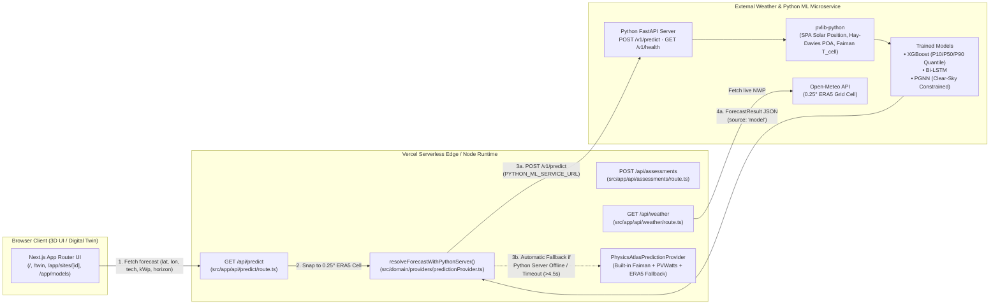
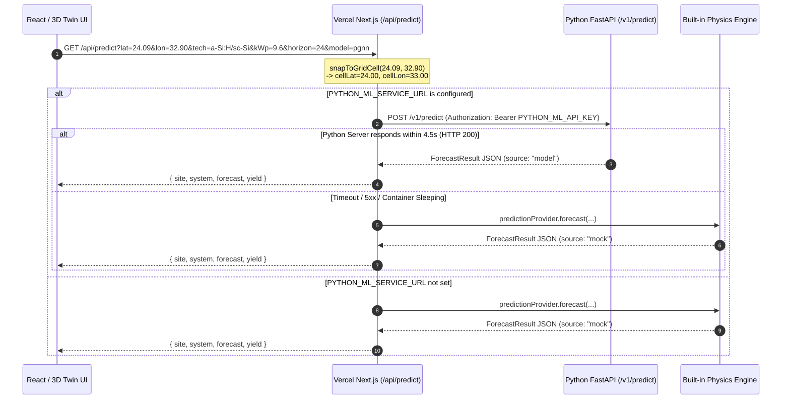

# SolarSense Platform · Python ML Server Integration & Vercel Deployment Guide

This document specifies how the **SolarSense Next.js Platform** (deployed on **Vercel**) communicates with the **Python FastAPI ML Inference Server** (`pvlib` + `XGBoost` / `LSTM` / `PGNN`) for solar power predictions, uncertainty bands ($P_{10}\text{–}P_{90}$), and physical clear-sky constraints.

---

## 1. End-to-End Architecture



---

## 2. Privacy & Grid-Cell Snapping Contract

Before the Next.js server sends any coordinates to either Open-Meteo or the Python ML Server, [`snapToGridCell(lat, lon)`](../src/domain/regions.ts) snaps the user's exact pin to the nearest **0.25° × 0.25° ERA5 grid cell center**:

$$\phi_{\text{cell}} = 0.25 \cdot \text{round}\!\left(\frac{\phi}{0.25}\right), \qquad \lambda_{\text{cell}} = 0.25 \cdot \text{round}\!\left(\frac{\lambda}{0.25}\right)$$

Only `cellId` (e.g., `ERA5_24.00N_32.75E`), `cellLat`, `cellLon`, and `region` are transmitted to the Python server.

---

## 3. Request & Response Flow (Sequence Diagram)



---

## 4. HTTP API Contract Between Next.js and Python Server

### 4.1 Endpoint: `POST /v1/predict`

Next.js calls `${process.env.PYTHON_ML_SERVICE_URL}/v1/predict` from [`resolveForecastWithPythonServer()`](../src/domain/providers/predictionProvider.ts).

#### Request Headers
```http
Content-Type: application/json
Authorization: Bearer <PYTHON_ML_API_KEY>
```

#### Request Body Schema
```json
{
  "site": {
    "cellId": "ERA5_24.00N_33.00E",
    "cellLat": 24.0,
    "cellLon": 33.0,
    "region": "nile-valley-upper-egypt"
  },
  "system": {
    "tech": "a-Si:H/sc-Si",
    "panelCount": 24,
    "kWp": 9.6,
    "tiltDeg": 22,
    "azimuthDeg": 180
  },
  "horizonH": 24,
  "mode": "live",
  "skyCondition": "clear",
  "dayOfYear": 135,
  "modelKey": "pgnn"
}
```

#### Response Body Schema (`ForecastResult` in [`src/domain/types.ts`](../src/domain/types.ts))
```json
{
  "issueTime": "2026-05-15T05:00:00+02:00",
  "horizonH": 24,
  "mode": "live",
  "source": "model",
  "modelName": "PGNN Clear-Sky Constrained Ensemble",
  "modelVersion": "v2.1-pvlib-era5-egypt",
  "points": [
    {
      "targetTime": "2026-05-15T12:00:00+02:00",
      "hourLocal": 12,
      "solarElevationDeg": 80.9,
      "ghiWm2": 982,
      "tAmbC": 41.2,
      "tCellC": 59.6,
      "kc": 0.94,
      "pKw": 6.74,
      "p10Kw": 6.12,
      "p90Kw": 7.15,
      "pClearKw": 6.91
    }
  ]
}
```

---

## 5. Governing Physics & ML Equations Inside the Python Pipeline

The Python server executes a 3-stage hybrid physics + ML pipeline:

1. **Solar Geometry & Transposition (`pvlib.solarposition.get_solarposition` + `pvlib.irradiance.get_total_irradiance`)**:
   $$G_{\text{POA}} = G_b \cos\theta_i + G_d\,\frac{1+\cos\beta}{2} + \rho\,G_h\,\frac{1-\cos\beta}{2}$$

2. **Faiman Cell Temperature & PVWatts Thermal Derating (`pvlib.temperature.faiman`)**:
   $$T_c = T_a + \frac{G_{\text{POA}}}{U_0 + U_1 v_w}, \qquad P_{\text{clear}}(t) = \eta_{\text{inv}}\,P_{\text{STC}}\,\frac{G_{\text{POA,clr}}(t)}{1000}\,\bigl[1 + \gamma\,(T_c(t) - 25^\circ\text{C})\bigr]$$
   where panel thermal coefficient $\gamma$ depends on `system.tech`:
   - `pc-Si`: $\gamma = -0.42\%/^\circ\text{C}$
   - `a-Si:H/sc-Si` (HJT): $\gamma = -0.26\%/^\circ\text{C}$
   - `CIGS`: $\gamma = -0.34\%/^\circ\text{C}$

3. **Clear-Sky Index Residual Forecasting & PGNN Physical Clamping**:
   The ML models predict the clear-sky index $k_c(t) = G_h(t) / G_{h,\text{clr}}(t)$ or normalized power, and enforce hard physical bounds so night-time power is strictly zero and daytime predictions never exceed the clear-sky ceiling:
   $$\hat{P}(t) = \operatorname{clip}\!\bigl(f_\theta(\mathbf{x}_t),\; 0,\; 1.05 \cdot P_{\text{clear}}(t)\bigr)$$
   $$\mathcal{L}_{\text{PGNN}} = \frac{1}{N}\sum_{t=1}^{N}(\hat{P}_t - P_t)^2 + \lambda_{\text{phy}}\,\frac{1}{N}\sum_{t=1}^{N}\Bigl[\max(0, -\hat{P}_t)^2 + \max(0, \hat{P}_t - 1.05\,P_{\text{clear},t})^2\Bigr]$$

---

## 6. Reference Python FastAPI Server (`main.py`)

Below is a complete, minimal FastAPI server that implements the exact contract expected by SolarSense:

```python
# main.py — SolarSense Python FastAPI ML Inference Service
# Run locally: uvicorn main:app --host 0.0.0.0 --port 8000 --reload

import os
from typing import Literal, List
import numpy as np
import pandas as pd
import pvlib
from fastapi import FastAPI, Header, HTTPException
from pydantic import BaseModel

app = FastAPI(title="SolarSense Python ML Server", version="2.1.0")

API_KEY = os.getenv("PYTHON_ML_API_KEY", "")

TECH_GAMMA = {
    "pc-Si": -0.0042,
    "a-Si:H/sc-Si": -0.0026,
    "CIGS": -0.0034,
}


class SiteInput(BaseModel):
    cellId: str
    cellLat: float
    cellLon: float
    region: str


class SystemInput(BaseModel):
    tech: Literal["pc-Si", "a-Si:H/sc-Si", "CIGS"]
    panelCount: int
    kWp: float
    tiltDeg: float
    azimuthDeg: float = 180.0


class PredictRequest(BaseModel):
    site: SiteInput
    system: SystemInput
    horizonH: Literal[1, 6, 24] = 24
    mode: Literal["replay", "live"] = "live"
    skyCondition: Literal["clear", "dust", "cloud", "heatwave"] = "clear"
    dayOfYear: int = 135
    modelKey: Literal["xgb", "lstm", "pgnn"] = "pgnn"


@app.get("/v1/health")
def health():
    return {"status": "ok", "engine": "pvlib+xgboost+lstm+pgnn"}


@app.post("/v1/predict")
def predict(req: PredictRequest, authorization: str | None = Header(default=None)):
    if API_KEY and authorization != f"Bearer {API_KEY}":
        raise HTTPException(status_code=401, detail="Invalid API Key")

    # 1. Build 15 daytime hourly timestamps in Africa/Cairo (05:00 .. 19:00)
    date_base = pd.Timestamp("2026-01-01", tz="Africa/Cairo") + pd.Timedelta(days=req.dayOfYear - 1)
    hours = list(range(5, 20))
    times = pd.DatetimeIndex([date_base + pd.Timedelta(hours=h - 0.5) for h in hours])

    # 2. pvlib SPA Solar Position & Ineichen Clear-Sky
    loc = pvlib.location.Location(req.site.cellLat, req.site.cellLon, tz="Africa/Cairo", altitude=120)
    solpos = loc.get_solarposition(times)
    cs = loc.get_clearsky(times, model="ineichen")

    # 3. Sky attenuation factor (or live NWP + XGBoost/LSTM/PGNN inference)
    kc_map = {"clear": 0.94, "dust": 0.66, "cloud": 0.58, "heatwave": 0.91}
    kc_val = kc_map.get(req.skyCondition, 0.94)
    gamma = TECH_GAMMA[req.system.tech]
    sys_eff = 0.86 * 0.98

    points = []
    for idx, h in enumerate(hours):
        elev = float(max(0.0, solpos["apparent_elevation"].iloc[idx]))
        ghi_clr = float(cs["ghi"].iloc[idx]) if elev > 0 else 0.0
        dni_clr = float(cs["dni"].iloc[idx]) if elev > 0 else 0.0
        dhi_clr = float(cs["dhi"].iloc[idx]) if elev > 0 else 0.0

        ghi = ghi_clr * kc_val
        poa_clr_df = pvlib.irradiance.get_total_irradiance(
            surface_tilt=req.system.tiltDeg,
            surface_azimuth=req.system.azimuthDeg,
            solar_zenith=float(solpos["apparent_zenith"].iloc[idx]),
            solar_azimuth=float(solpos["azimuth"].iloc[idx]),
            dni=dni_clr,
            ghi=ghi_clr,
            dhi=dhi_clr,
        )
        poa_clr = float(max(0.0, poa_clr_df["poa_global"])) if elev > 0 else 0.0
        poa = poa_clr * kc_val

        t_amb = 28.0 + 10.0 * np.sin(((h - 6) / 14.0) * np.pi)
        t_cell = float(pvlib.temperature.faiman(poa, t_amb, wind_speed=3.8))
        temp_factor = max(0.70, 1.0 + gamma * (t_cell - 25.0))

        p_clear = round(req.system.kWp * (poa_clr / 1000.0) * temp_factor * sys_eff, 2)
        raw_pred = req.system.kWp * (poa / 1000.0) * temp_factor * sys_eff

        # 4. PGNN Physical Clamping: 0 <= P_hat <= 1.05 * P_clear
        p_kw = round(float(np.clip(raw_pred, 0.0, 1.05 * p_clear)), 2)
        spread = 0.08 * (1.0 if req.horizonH == 1 else 1.35 if req.horizonH == 6 else 1.65)
        p10 = round(max(0.0, p_kw * (1.0 - spread)), 2)
        p90 = round(min(1.05 * p_clear, p_kw * (1.0 + spread * 0.85)), 2)

        points.append({
            "targetTime": f"2026-05-15T{h:02d}:00:00+02:00",
            "hourLocal": h,
            "solarElevationDeg": round(elev, 1),
            "ghiWm2": round(ghi),
            "tAmbC": round(t_amb, 1),
            "tCellC": round(t_cell, 1),
            "kc": round(kc_val, 2),
            "pKw": p_kw,
            "p10Kw": p10,
            "p90Kw": max(p_kw, p90),
            "pClearKw": p_clear,
        })

    return {
        "issueTime": "2026-05-15T05:00:00+02:00",
        "horizonH": req.horizonH,
        "mode": req.mode,
        "points": points,
        "source": "model",
        "modelName": f"{req.modelKey.upper()} + pvlib Constrained Ensemble",
        "modelVersion": "v2.1-pvlib-era5-egypt",
    }
```

---

## 7. Deploying to Vercel (Step-by-Step)

### Option A: Deploy via GitHub + Vercel Dashboard (Recommended)
1. Push your latest commit to GitHub (`https://github.com/YousefElbooz/SolarSensePlatform.git`).
2. Go to [vercel.com/new](https://vercel.com/new) and import `YousefElbooz/SolarSensePlatform`.
3. Keep the default **Next.js** framework preset (`Build Command: next build`, `Output Directory: .next`).
4. (Optional) Under **Environment Variables**, add:
   - `PYTHON_ML_SERVICE_URL` = `https://your-python-ml-service.up.railway.app` (or Render / Cloud Run / HuggingFace Spaces URL)
   - `PYTHON_ML_API_KEY` = `your-secret-bearer-token`
   *(Note: Even if you leave `PYTHON_ML_SERVICE_URL` blank initially, the platform works 100% out-of-the-box on Vercel using the built-in `PhysicsAtlasPredictionProvider` and live Open-Meteo API!)*
5. Click **Deploy**.

### Option B: Deploy via Vercel CLI
```powershell
npx vercel login
npx vercel --prod
```
