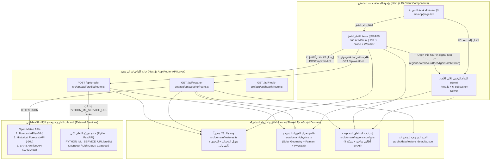
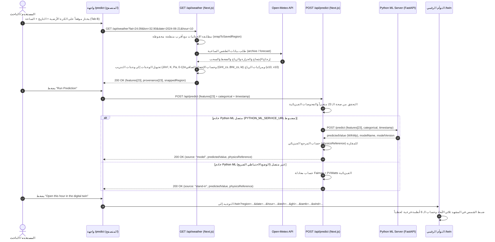

# دليل التصميم المعماري والملخص العلمي لمنصة SolarSense (باللغة العربية)

يجمع هذا المستند **ملخصاً علمياً وهندسياً باللغة العربية** لجميع الأسئلة الجوهرية حول منصة **SolarSense** (وهي الأسئلة الأكثر شيوعاً في مناقشات مشاريع التخرج)، متبوعاً بـ **التصميم المعماري الشامل للنظام (High-Level System Design)** ومخططات تدفق البيانات وعقود الطلبات والاستجابات (**Request / Response Contracts**) لكل خدمة.

---

## الجزء الأول: ملخص الأسئلة والأجوبة العلمية (سؤال وجواب)

### س1: ما هي وظيفة كل صفحة من الصفحات الثلاث في منصة SolarSense؟

تتكون المنصة في نسختها المركّزة من **3 صفحات رئيسية فقط**:

| الصفحة | المسار | الوظيفة الأساسية |
|---|---|---|
| **1. المقدمة القَصصية (Intro)** | [`/`](../src/app/page.tsx) | تشرح المشكلة الهندسية في مصر (فقدان الكفاءة الحراري في الصيف)، وتقارن بين 3 تقنيات للألواح (`pc-Si` و `a-Si:H/sc-Si` و `CIGS`)، وتستعرض الأقاليم المناخية الأربعة في مصر، وتعرض **الـ 23 متغيراً جوياً (ERA5 + PVGIS)** التي يعتمد عليها نموذج الذكاء الاصطناعي. |
| **2. التوأم الرقمي (Digital Twin)** | [`/twin`](../src/app/twin/page.tsx) | **محاكاة هندسية ثلاثية الأبعاد (3D)** لمحطة طاقة شمسية متكاملة (الشمس $\leftarrow$ مصفوفة الألواح $\leftarrow$ العاكس الهجين $\leftarrow$ بطاريات $\text{LiFePO}_4$ $\leftarrow$ أحمال المبنى $\leftarrow$ شبكة الكهرباء). تعمل لحظياً بسرعة 60 إطاراً/ثانية داخل المتصفح بناءً على المعادلات الفيزيائية. |
| **3. منصة اختبار التنبؤ (Prediction Test)** | [`/predict`](../src/app/predict/page.tsx) | **بيئة اختبار نموذج التعلم الآلي (ML Test Bench)**؛ تتيح إدخال الـ 23 متغيراً يدوياً (**Tab A**) أو اختيار موقع وتاريخ وساعة على الكرة الأرضية التفاعلية لسحب طقس حقيقي من Open-Meteo وتحويله لوحدات التدريب (**Tab B**)، ثم إرسالها إلى [`POST /api/predict`](../src/app/api/predict/route.ts). |

---

### س2: كيف تقوم المنصة بالحساب في صفحة التنبؤ (`/predict`) والتوأم الرقمي (`/twin`) قبل ربط خادم الذكاء الاصطناعي (Python ML Model)؟

المنصة **لا تستخدم أرقاماً عشوائية أبداً**. في حال عدم تشغيل خادم Python (`PYTHON_ML_SERVICE_URL` غير مضبوط)، تعتمد المنصة على **المعادلات الفيزيائية القياسية المعتمدة دولياً** في هندسة الطاقة الشمسية والمبرمجة في [`src/domain/physics.ts`](../src/domain/physics.ts) و [`src/domain/providers/predictionProvider.ts`](../src/domain/providers/predictionProvider.ts).

تتم الحسابات عبر 3 معادلات فيزيائية متتالية:

1. **معادلة الفلك الشمسي والإشعاع الصافي (Ineichen–Perez & Kasten–Young):**
   تحسب زاوية ارتفاع الشمس $\alpha_s$ والكتلة الهوائية $AM$ والإشعاع الساقط على اللوح المائل $G_{POA}$:
   $$\sin \alpha_s = \sin\varphi\sin\delta + \cos\varphi\cos\delta\cos\omega$$
2. **معادلة فايمان لحرارة الخلية الشمسية (Faiman Cell Temperature — IEC 61853-2):**
   تحسب ارتفاع حرارة الخلية $T_{cell}$ فوق حرارة الجو $T_{amb}$ بسبب الشمس، وتأثير التبريد بالرياح $v_{wind}$:
   $$T_{cell} = T_{amb} + \frac{G}{U_0 + U_1 \cdot v_{wind}} \quad (U_0 = 25.0,\; U_1 = 6.84)$$
3. **معادلة PVWatts للقدرة والفقد الحراري:**
   تطبق معامل الفقد الحراري $\gamma$ الخاص بكل تقنية (`-0.41%/°C` للسيليكون متعدد التبلور `pc-Si`، و `-0.26%/°C` للخلايا غير المتجانسة `a-Si:H/sc-Si`، و `-0.35%/°C` لـ `CIGS`):
   $$P = G \cdot \left[1 + \gamma \cdot (T_{cell} - 25^\circ\text{C})\right] \cdot (1 - L_{sys})$$

* في صفحة **`/predict`**: عند غياب خادم Python، يتم حساب الناتج بهذه المعادلة الفيزيائية ويوضع بوضوح شارة **`Physics stand-in`** (`source: "stand-in"`) حتى يعرف المستخدم أن الناتج فيزيائي بديل وليس من نموذج الذكاء الاصطناعي.
* بمجرد ربط خادم Python عبر المتغير `PYTHON_ML_SERVICE_URL`، تتحول الشارة تلقائياً إلى **`Model`** (`source: "model"`)، وتبقى المعادلة الفيزيائية معروضة أسفلها كـ **مرجع فيزيائي للمقارنة (`Physics Reference`)**.

---

### س3: ما الفرق الجوهري بين التوأم الرقمي (`/twin`) وصفحة التنبؤ (`/predict`)؟

| وجه المقارنة | التوأم الرقمي (`/twin`) | صفحة اختبار التنبؤ (`/predict`) |
|---|---|---|
| **الفلسفة العلمية** | **نموذج فيزيائي صريح (White-Box Physics):** يحاكي القوانين الفيزيائية والكهربائية لكل جزء في المحطة. | **نموذج مبني على البيانات (Data-Driven ML):** يستقبل متجه من 23 متغيراً جوياً $\mathbf{x} \in \mathbb{R}^{23}$ ليتنبأ بالإنتاجية الساعية. |
| **المدخلات (Inputs)** | عناصر تحكم تفاعلية سريعة: شريط الوقت (من الفجر للغروب)، الفصل الدراسي، حالة السماء (`clear`, `dust`, `cloud`, `heatwave`)، عدد الألواح، ونوع التقنية. | **23 متغيراً مناخياً دقيقاً** بوحدات مجموعة البيانات (`J/m²`, `K`, `Pa`, `m/s`) + المنطقة الجغرافية + تقنية اللوح + التاريخ والساعة (UTC). |
| **نطاق المخرجات** | **6 أنظمة فرعية مترابطة:** حركة الشمس، حرارة الألواح $T_c$، قدرة العاكس $P_{AC}$، شحن البطارية $\text{SoC}$، استهلاك المبنى $P_{load}$، والتصدير للشبكة $P_{grid}$. | **قيمة تنبؤ نقطية دقيقة ($\text{W/kWp}$)** لساعة محددة + مقارنة مع المرجع الفيزيائي + فاحص JSON للطلب والاستجابة. |
| **طريقة الربط بينهما** | يستقبل بيانات أي ساعة قادمة من صفحة التنبؤ عبر الرابط (`?region=...&date=...&hour=...&ghi=...`). | يحتوي على زر **"Open this hour in the digital twin"** لنقل حالة الطقس المختبرة فوراً إلى المشهد ثلاثي الأبعاد. |

---

### س4: طالما توجد معادلة فيزيائية ومكتبة `pvlib`، لماذا نصنع نموذج تعلم آلي (ML Model) يعتمد على 23 متغيراً؟

هذا هو **أهم سؤال في مناقشة مشروع التخرج**، وإجابته تتلخص في 5 نقاط علمية:

1. **المعادلة الفيزيائية البسيطة ترى 4 متغيرات فقط وتجاهل 19 متغيراً آخر:**
   معادلة Faiman + PVWatts تستخدم ($G, T_{amb}, v_w, \gamma$) فقط، وتفترض أن الفقد الحراري خطي تماماً وأن فواقد النظام ثابتة ($14\%$).
2. **التأثير الطيفي وبخار الماء (`tcwv`, `d2m`, `sp`, `tp`):**
   الألواح الرقيقة (`a-Si:H/sc-Si` و `CIGS`) لها استجابة طيفية (Spectral Response) مختلفة عن السيليكون التقليدي `pc-Si`. تغير عمود بخار الماء في الجو (`tcwv`) بين سواحل الدلتا وصحراء أسوان يغير طيف الضوء الساقط، وهو ما يتعلمه نموذج الـ ML من الـ 23 متغيراً ولا وجود له في المعادلة البسيطة.
3. **تفصيل طبقات السحب والإشعاع المباشر والمشتت (`BHI`, `DHI`, `BNI`, `kt`, `tcc`, `hcc`, `mcc`, `lcc`):**
   السحب العالية الرقيقة (`hcc`) تشتت الضوء (`DHI`) ولا تحجبه بالكامل، بينما السحب المنخفضة (`lcc`) تقطع الشعاع المباشر (`BNI`). كما أن زجاج اللوح يعكس الإشعاع المباشر والمشتت بنسب مختلفة عند الزوايا المنخفضة للشمس.
4. **انعكاس الأرض وحرارة التربة (`fal`, `stl1`, `swvl1`):**
   معامل انعكاس الرمال الصحراوية في مصر (`fal ≈ 0.30`) أعلى بكثير من الأراضي الزراعية في الدلتا (`fal ≈ 0.15`)، كما أن حرارة التربة السطحية (`stl1`) ورطوبتها (`swvl1`) تؤثران على الإشعاع الحراري الخلفي للوح.
5. **اتجاه الرياح الفعلي (`u10`, `v10`):**
   تبريد اللوح المائل نحو الجنوب يختلف إذا كانت الرياح تهب في مواجهة سطح اللوح (`v10`) مقارنة بهبوبها موازية لصفوف الألواح (`u10`).

---

### س5: كيف يعمل التوأم الرقمي (`/twin`) داخل الموقع بدون استدعاء مكتبة `pvlib` في Python؟

مكتبة `pvlib` في لغة Python ليست برنامجاً سحرياً مغلقاً، بل هي **مجموعة من المعادلات الرياضية والفيزيائية المنشورة علمياً**.
لو قمنا بإرسال طلب HTTP إلى خادم Python في كل مرة يحرك فيها المستخدم شريط الوقت في المشهد ثلاثي الأبعاد، سيحدث تأخير (Lag) ولن يعمل المشهد بسرعة 60 إطاراً في الثانية.

لذلك قمنا **ببرمجة نفس معادلات `pvlib` الرياضية مباشرة بلغة TypeScript** داخل الملف [`src/domain/physics.ts`](../src/domain/physics.ts):

| المرحلة في التوأم الرقمي (`/twin`) | الدالة في [`src/domain/physics.ts`](../src/domain/physics.ts) | الدالة المكافئة لها في `pvlib` (Python) |
|---|---|---|
| **1. موقع الشمس الفلكي ($\alpha_s, \gamma_s, \delta$)** | `computeSolarPosition()` | `pvlib.solarposition.get_solarposition()` |
| **2. الكتلة الهوائية والإشعاع الصافي** | `simulateIrradianceAndPoa()` / `calculateClearSky()` | `pvlib.atmosphere.get_relative_airmass()` + `pvlib.clearsky.ineichen()` |
| **3. تحويل الإشعاع للسطح المائل ($G_{POA}$)** | `simulateIrradianceAndPoa()` | `pvlib.irradiance.get_total_irradiance(model='isotropic')` |
| **4. حرارة الخلية الشمسية ($T_{cell}$)** | `simulatePvPowerStep()` | `pvlib.temperature.faiman()` |
| **5. قدرة التيار المستمر والمتردد ($P_{DC}, P_{AC}$)** | `simulatePvPowerStep()` | `pvlib.pvsystem.pvwatts_dc()` + `pvlib.inverter.pvwatts()` |

وبذلك ينفذ المتصفح سلسلة معادلات `pvlib` كاملة في **أقل من 0.1 مللي ثانية** لكل إطار.

---

## الجزء الثاني: التصميم المعماري الشامل لنظام SolarSense (High-Level System Design)

### 1. مخطط البنية المعمارية العامة (System Architecture Diagram)



---

### 2. مخطط تسلسل العمليات (Sequence Diagram) لرحلة التنبؤ والمحاكاة



---

## الجزء الثالث: شرح الخدمات وعقود الطلبات والاستجابات (Request / Response Contracts)

### الخدمة الأولى: خدمة جلب ومعالجة الطقس (`GET /api/weather`)
* **الملف المسؤول:** [`src/app/api/weather/route.ts`](../src/app/api/weather/route.ts) و [`src/domain/providers/weatherProvider.ts`](../src/domain/providers/weatherProvider.ts)
* **الوظيفة:**
  1. تستقبل خط العرض `lat` وخط الطول `lon` والتاريخ `date` والساعة `hour` (بتوقيت UTC).
  2. تطابق الإحداثيات مع الأقاليم المناخية المحفوظة في مصر عبر `snapToSavedRegion` (وترفض الإحداثيات خارج نطاق تغطية الشبكة بكود `400`).
  3. تختار نقطة النهاية المناسبة في Open-Meteo حسب التاريخ (`forecast`, `recent`, `archive`).
  4. تحول جميع القيم إلى وحدات تدريب النموذج (`W/m² × 3600 → J/m²`، `°C + 273.15 → K`، `hPa × 100 → Pa`، `% ÷ 100 → 0..1`)، وتحسب مركبتي الرياح `(u10, v10)` والإشعاع الصافي `(GHI_cs, BHI_cs, DHI_cs, BNI_cs, kt)`، وتوثق مصدر كل متغير في حقل `provenance` (`"api"` أو `"calculated"` أو `"default"`).

#### مثال الطلب (Request)
```http
GET /api/weather?lat=24.09&lon=32.90&date=2024-06-21&hour=10 HTTP/1.1
```

#### مثال الاستجابة الناجحة (Response `200 OK`)
```json
{
  "features": {
    "GHI": 3528000,
    "BHI": 3042000,
    "DHI": 486000,
    "BNI": 3276000,
    "GHI_cs": 3672000,
    "BHI_cs": 3240000,
    "DHI_cs": 432000,
    "BNI_cs": 3456000,
    "kt": 0.9608,
    "t2m": 313.15,
    "d2m": 281.15,
    "stl1": 317.15,
    "u10": -1.3,
    "v10": -3.57,
    "sp": 100900,
    "tp": 0,
    "tcwv": 14.2,
    "swvl1": 0.04,
    "tcc": 0.05,
    "hcc": 0.02,
    "mcc": 0.02,
    "lcc": 0.01,
    "fal": 0.3
  },
  "provenance": {
    "GHI": "api",
    "BHI": "calculated",
    "DHI": "api",
    "BNI": "api",
    "GHI_cs": "calculated",
    "BHI_cs": "calculated",
    "DHI_cs": "calculated",
    "BNI_cs": "calculated",
    "kt": "calculated",
    "t2m": "api",
    "d2m": "api",
    "stl1": "api",
    "u10": "calculated",
    "v10": "calculated",
    "sp": "api",
    "tp": "api",
    "tcwv": "default",
    "swvl1": "api",
    "tcc": "api",
    "hcc": "api",
    "mcc": "api",
    "lcc": "api",
    "fal": "default"
  },
  "snappedRegion": {
    "id": "nile-valley-upper-egypt",
    "code": "R1",
    "nameEn": "Upper Egypt & Nile Valley (Aswan / Benban)",
    "nameAr": "صعيد مصر ووادي النيل (أسوان / بنبان)",
    "distanceKm": 0
  },
  "endpointUsed": "archive",
  "timestampUtc": "2024-06-21T10:00:00Z",
  "warnings": []
}
```

---

### الخدمة الثانية: خدمة التنبؤ بالقدرة الشمسية (`POST /api/predict`)
* **الملف المسؤول:** [`src/app/api/predict/route.ts`](../src/app/api/predict/route.ts) و [`src/domain/providers/predictionProvider.ts`](../src/domain/providers/predictionProvider.ts)

#### مثال الطلب (Request `POST /api/predict`)
```json
{
  "features": {
    "GHI": 3528000,
    "BHI": 3042000,
    "DHI": 486000,
    "BNI": 3276000,
    "GHI_cs": 3672000,
    "BHI_cs": 3240000,
    "DHI_cs": 432000,
    "BNI_cs": 3456000,
    "kt": 0.9608,
    "t2m": 313.15,
    "d2m": 281.15,
    "stl1": 317.15,
    "u10": -1.3,
    "v10": -3.57,
    "sp": 100900,
    "tp": 0,
    "tcwv": 14.2,
    "swvl1": 0.04,
    "tcc": 0.05,
    "hcc": 0.02,
    "mcc": 0.02,
    "lcc": 0.01,
    "fal": 0.3
  },
  "categorical": {
    "Region": "nile-valley-upper-egypt",
    "PV_Technology": "a-Si:H/sc-Si"
  },
  "timestamp": {
    "date": "2024-06-21",
    "hour": 10
  }
}
```

#### مثال الاستجابة في حال اتصال نموذج Python ML (`source: "model"`)
```json
{
  "predictedValue": 742.5,
  "unit": "W/kWp",
  "source": "model",
  "modelName": "XGBoost-PV-Egypt",
  "modelVersion": "v2.1",
  "physicsReference": {
    "value": 731.8,
    "unit": "W/kWp",
    "equation": "P = G_h * [1 + gamma * (T_cell - 25)] * (1 - L_sys)"
  },
  "warnings": []
}
```

#### مثال الاستجابة في الوضع الفيزيائي البديل (`source: "stand-in"`)
```json
{
  "predictedValue": 731.8,
  "unit": "W/kWp",
  "source": "stand-in",
  "physicsReference": {
    "value": 731.8,
    "unit": "W/kWp",
    "equation": "P = G_h * [1 + gamma * (T_cell - 25)] * (1 - L_sys)"
  },
  "warnings": []
}
```

---

### الخدمة الثالثة: خدمة فحص حالة النظام (`GET /api/health`)
* **الملف المسؤول:** [`src/app/api/health/route.ts`](../src/app/api/health/route.ts)

```json
{
  "status": "ok",
  "service": "SolarSense Platform (Focused 3-Page Edition)",
  "timestamp": "2026-11-14T09:55:00.000Z",
  "era5GridCells": 1665,
  "savedRegions": [
    "nile-valley-upper-egypt",
    "western-desert",
    "sinai-red-sea",
    "north-coast-delta"
  ],
  "featureCount": 23,
  "pythonMlServerConfigured": false,
  "predictionSource": "stand-in"
}
```
